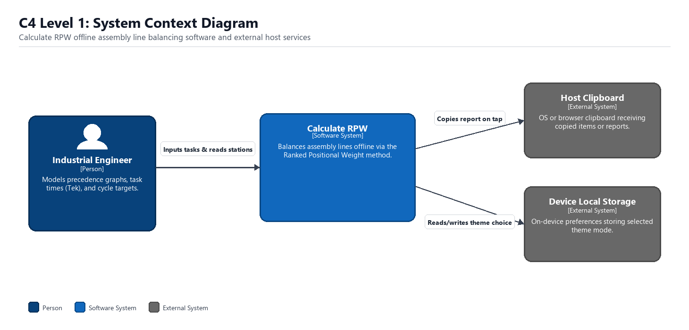
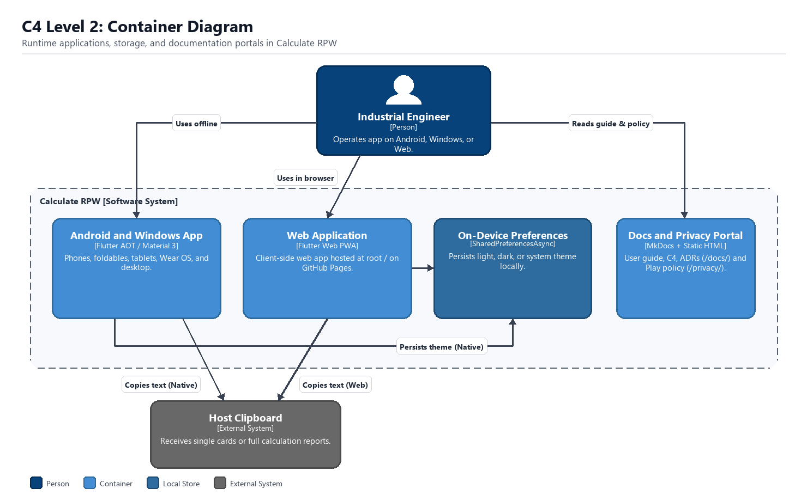
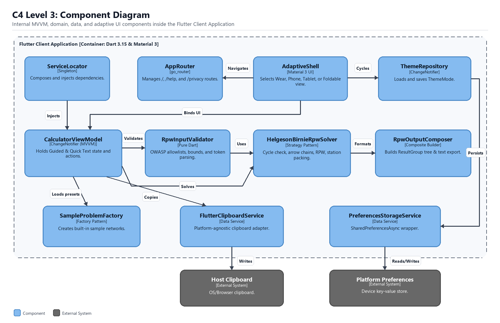
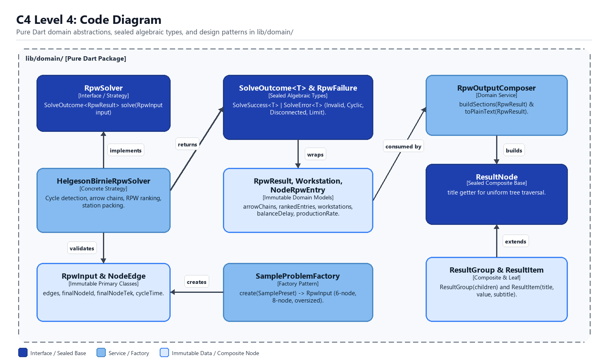

# Software Architecture and C4 Model

Calculate RPW uses a layered, platform-agnostic architecture separating pure Dart RPW domain logic from data adapters and adaptive Material 3 UI components.

## C4 Level 1: System Context

Shows how an industrial engineer uses Calculate RPW alongside local device preferences and the host clipboard.

- Structurizr DSL: [01-system-context.dsl](c4/01-system-context.dsl)

## C4 Level 2: Containers

Shows the runtime containers across Android, Windows desktop, Flutter Web, local preferences storage, and the documentation portal.

- Structurizr DSL: [02-containers.dsl](c4/02-containers.dsl)

## C4 Level 3: Components

Shows internal components inside the Flutter client application: `AdaptiveShell`, `AppRouter`, `CalculatorViewModel`, `RpwInputValidator`, `HelgesonBirnieRpwSolver`, `RpwOutputComposer`, `SampleProblemFactory`, `ThemeRepository`, and platform service wrappers.

- Structurizr DSL: [03-components.dsl](c4/03-components.dsl)

## C4 Level 4: Code

Shows the pure Dart domain types and design patterns (Strategy, Composite, Factory, and Sealed algebraic outcomes).

- Structurizr DSL: [04-code.dsl](c4/04-code.dsl)

