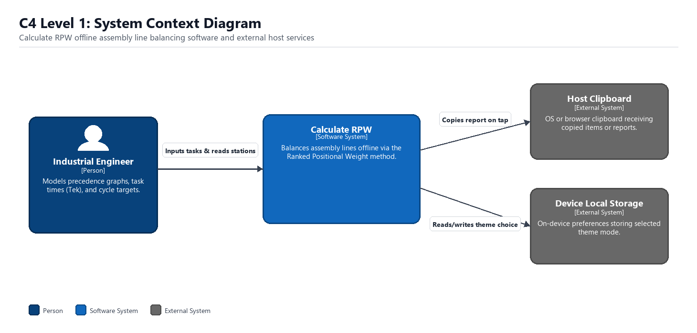
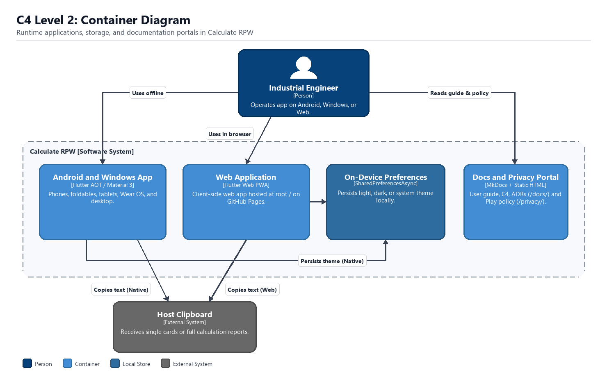
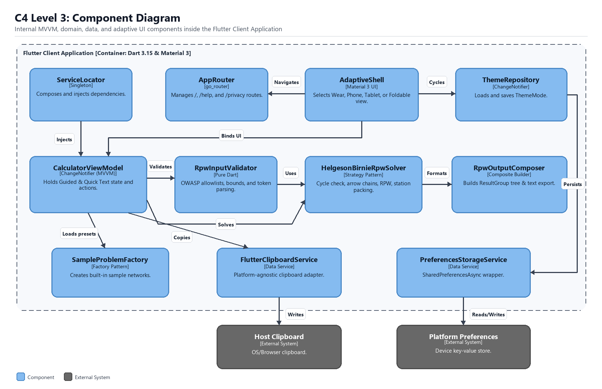
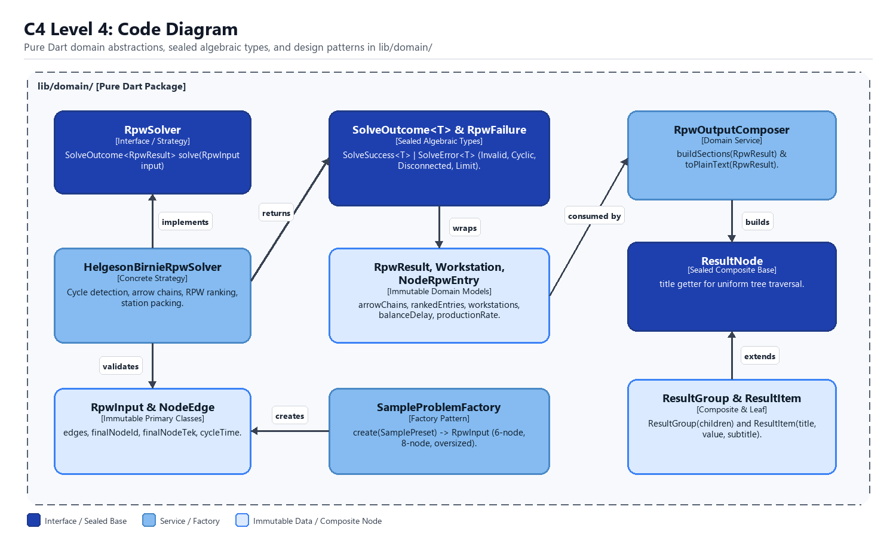

# Calculate RPW

Offline, cross-platform assembly line balancing calculator implementing the Helgeson and Birnie Ranked Positional Weight (RPW) method with Material 3.

- **Live Web App**: [Calculate RPW Web App](https://makeshvineeth.github.io/ranked_positional_weight_method/)
- **Documentation Portal**: [MkDocs Guide, C4 Architecture, and ADRs](https://makeshvineeth.github.io/ranked_positional_weight_method/docs/)
- **Privacy Policy**: [Standalone Privacy Policy](https://makeshvineeth.github.io/ranked_positional_weight_method/privacy/)

## Features

- **Guided Form and Quick Text Modes**: Enter precedence edges (`From`, `To`, `Tek`), final task, and cycle time via visual cards or fast space-separated lines.
- **Built-in Sample Networks**: One-tap loading for a 6-node classic textbook problem, an 8-node parallel assembly line, and an oversized-task edge case.
- **Full RPW Diagnostics**: Computes forward arrow chains, ranked RPW priority table with predecessors, balanced workstations, idle times, balance delay, line efficiency, and production rate.
- **Responsive Across Form Factors**: Adapts automatically to phones (mini to large), foldables (hinge-aware split layout), tablets, Wear OS watches (under 300dp), resizable desktop windows, and Web browsers.
- **Tap-to-Copy Output**: Tap any result card to copy a single value or copy the full plain-text report.
- **Offline and Permission-Free**: Runs completely on-device with zero telemetry, zero ads, and zero special Android permissions.

## Architecture (C4 Model)

Structurizr DSL source files live under [`.docs/architecture/c4/`](.docs/architecture/c4/) alongside Architecture Decision Records in [`.docs/adrs/`](.docs/adrs/).

### Level 1: System Context



### Level 2: Containers



### Level 3: Components



### Level 4: Code



## Project Layout

```text
lib/
├── app/       # Singleton dependency composition (ServiceLocator) and go_router routes
├── core/      # Constants, number formatting, and WindowSizeClass adaptive breakpoints
├── data/      # Local preferences repository and platform-agnostic clipboard adapter
├── domain/    # Pure Dart RPW models, OWASP input validator, solver strategy, and composite composer
└── ui/        # Material 3 theme, adaptive shell, Calculator (Guided, Quick Text, Wear), Help, and Privacy
```

## Development and Verification

Run formatting, strict static analysis, and all unit and widget tests:

```sh
flutter pub get
dart format --output=none --set-exit-if-changed lib test
dart analyze --fatal-infos lib test
flutter test
```

Build release targets:

```sh
flutter build apk --release
flutter build web --release --wasm --base-href /ranked_positional_weight_method/
flutter build windows --release
```

Build documentation locally with MkDocs:

```sh
python -m mkdocs build
```
